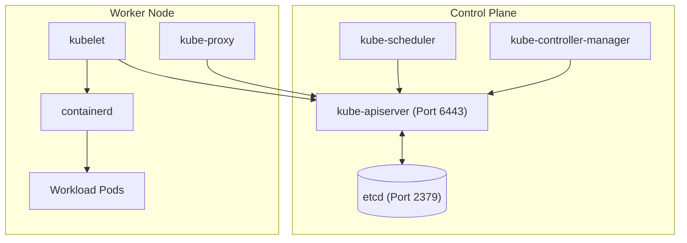

# VOLUME I: THE COMPLETE CKA TEXTBOOK
# PART I: KUBERNETES FUNDAMENTALS
## CHAPTERS 1–4: CONTAINERIZATION, OCI ARCHITECTURE & CLUSTER COMPONENTS

---

### CHAPTER 1: INTRODUCTION TO CONTAINERIZATION AND KUBERNETES

#### 1. Learning Objectives
* Understand the evolution from bare metal and virtual machines to containers.
* Identify the operational bottlenecks that Kubernetes was engineered to solve.
* Articulate the core responsibilities of a production container orchestrator.

#### 2. Prerequisites
* Familiarity with Linux command-line basics (`ls`, `ps`, `cat`, `systemctl`).
* Basic comprehension of operating system concepts: kernel, user space, and process execution.

#### 3. Beginner-Friendly Introduction: Why Do Containers and Kubernetes Exist?
In the early days of computing, applications ran directly on bare-metal servers. A server running an operating system like Linux or Windows ran all binaries together. If an application leaked memory or monopolized the CPU, every other process on that host starved. Furthermore, dependency conflicts—such as Application A requiring Python 3.8 and Application B requiring Python 3.12—made server management brittle.

Virtual Machines (VMs) solved isolation by placing a hypervisor (e.g., KVM, VMware) on the hardware and running entire independent guest operating systems. However, VMs carry massive overhead: every VM requires gigabytes of disk storage for its guest kernel, takes minutes to boot, and wastes gigabytes of RAM running duplicate operating system services.

Containers offer an elegant, lightweight alternative: **Process-level virtualization**. Containers do not run a guest kernel; they run as isolated processes directly on the host Linux kernel, sharing its CPU and memory while maintaining strict namespace boundaries.

However, running hundreds of standalone containers across dozens of physical servers creates new operational challenges:
* What happens when a container crashes at 3:00 AM?
* How do containers discover and communicate with each other across different servers?
* How do we roll out new application versions without dropping customer traffic?
* Which server has enough CPU and memory to host a new container?

**Kubernetes** is the open-source container orchestration system that automates deployment, scaling, healing, and management of containerized workloads.

#### 4. Detailed Conceptual Explanation & Internal Architecture
At the kernel level, a container is not an actual physical object; it is a standard Linux process isolated by two fundamental kernel subsystems:
1. **Linux Namespaces (Isolation):** Restricts *what a process can see*.
   * `pid`: Process IDs (a containerized process believes it is PID 1).
   * `net`: Network interfaces, IP addresses, routing tables, and firewall rules.
   * `mnt`: Filesystem mount points (isolates root `/` via pivot_root).
   * `ipc`: System V IPC and POSIX message queues.
   * `uts`: Hostname and NIS domain name.
   * `user`: Maps container root (UID 0) to an unprivileged user on the host.
2. **Control Groups / Cgroups (Resource Metering):** Restricts *how much a process can use*.
   * Limits maximum CPU shares, CFS bandwidth quotas, memory caps, and disk I/O throughput.

Kubernetes abstracts these low-level Linux primitives into resilient, high-level API objects.

---

### CHAPTER 2: CONTAINER ARCHITECTURE AND OCI STANDARDS

#### 1. The Open Container Initiative (OCI)
To avoid vendor lock-in, the industry established the Open Container Initiative (OCI), which governs two core standards:
1. **OCI Image Specification:** Defines the layout and format of container images (tarballs containing root filesystems and JSON manifest descriptors).
2. **OCI Runtime Specification:** Defines how to unpack and execute an OCI image as a set of Linux namespaces and cgroups (implemented by low-level runtimes like `runc` and `crun`).

#### 2. The Container Runtime Interface (CRI)
In early Kubernetes releases, the `kubelet` directly integrated with Docker via a hardcoded internal bridge called `dockershim`. In Kubernetes v1.24+, `dockershim` was completely removed. Modern Kubernetes communicates with container runtimes strictly through the **Container Runtime Interface (CRI)**, a gRPC API.

```
┌─────────┐      CRI gRPC       ┌──────────────┐     OCI Runtime      ┌──────┐
│ kubelet │ ──────────────────> │  containerd  │ ───────────────────> │ runc │
└─────────┘  /run/containerd/   └──────────────┘   forks container    └──────┘
             containerd.sock           │
                                       ▼
                              ┌──────────────────┐
                              │ containerd-shim  │ ──> [Container Process]
                              └──────────────────┘
```

#### 3. Container Runtime Troubleshooting Workflow
When a node reports container runtime issues, verify containerd with:
```bash
# Verify systemd service status
systemctl status containerd

# Query active pod sandboxes via CRI CLI
crictl pods

# Check containerd configuration socket
ls -la /run/containerd/containerd.sock
```

---

### CHAPTER 3: KUBERNETES ARCHITECTURE & HIGH-LEVEL DESIGN

#### 1. Control Plane vs. Worker Nodes
A Kubernetes cluster consists of two distinct operational tiers:
1. **The Control Plane:** The cluster's nervous system. It makes global decisions (scheduling, detecting node failures, maintaining desired replica counts) and stores the definitive state.
2. **Worker Nodes:** The compute workhorses. They host the application containers, provide network routing, and execute health checks.



---

### CHAPTER 4: CONTROL PLANE AND WORKER NODE COMPONENTS DEEP DIVE

#### 1. kube-apiserver
The central REST API gateway. Every administrative command from `kubectl`, every scheduling binding from `kube-scheduler`, and every heartbeat from `kubelet` connects to `kube-apiserver`.
* **State Statelessness:** The API server stores no state locally; all data is persisted in `etcd`.
* **Security Gate:** Enforces Authentication, Authorization (RBAC), and Admission Control.

#### 2. etcd
A distributed, consistent key-value store implementing the Raft consensus algorithm. It is the single source of truth for the entire cluster.
* **Ports:** Port 2379 (Client requests from apiserver); Port 2380 (Peer communication among etcd members).
* **Quorum Rule:** Requires $\lfloor N/2 \rfloor + 1$ members to commit writes.

#### 3. kube-scheduler
Watches for newly created Pods that have no `nodeName` assigned. It evaluates filtering predicates (hard constraints) and scoring priorities (soft preferences) to select the optimal worker node.

#### 4. kube-controller-manager (KCM)
A single binary compiling multiple control loops (Replication Controller, Node Controller, Endpoints Controller, ServiceAccount Controller). Each loop continuously drives actual cluster state toward the desired state.

#### 5. kubelet (Worker Node Agent)
Runs as a native `systemd` daemon on every node (not inside a container).
* Interprets `PodSpec` objects and calls CRI to create/destroy containers.
* Mounts storage volumes and configures network namespaces.
* Continuously executes liveness, readiness, and startup probes.
* Posts node health heartbeats (Leases) back to the API server.

#### 6. kube-proxy (Network Director)
Runs on every node (typically as a DaemonSet). Watches Services and EndpointSlices, configuring host `iptables` or `IPVS` rules to load-balance traffic directed at Service virtual IPs across healthy backend Pods.

---

### PRACTICE EXERCISES & KNOWLEDGE CHECK (CHAPTERS 1–4)

#### Part A: Knowledge Check Questions
1. Why was `dockershim` removed from Kubernetes, and what interface replaced it?
2. Which control plane component communicates directly with `etcd`?
3. What is the minimum number of nodes required to survive 2 simultaneous node failures in an etcd cluster?
4. Explain the difference between Linux namespaces and cgroups.

#### Part B: Solutions
1. `dockershim` was removed to decouple Kubernetes from proprietary Docker code; it was replaced by the standardized Container Runtime Interface (CRI).
2. Only `kube-apiserver` communicates with `etcd`.
3. An etcd cluster requires 5 nodes to tolerate 2 node failures ($5/2 + 1 = 3$ quorum required).
4. Namespaces isolate visibility (what a process sees); cgroups meter and throttle resource consumption (how much CPU/RAM it can use).

#### Part C: Revision Checklist
- [ ] Memorized the 6 primary cluster components.
- [ ] Understand why kubelet runs as a systemd service while other components run as static pods.
- [ ] Able to run `crictl pods` and `systemctl status containerd` on a broken node.
