# VOLUME III: THE KUBERNETES VISUAL ARCHITECTURE ATLAS
## PART 1: CORE ARCHITECTURE & PACKET FLOW SCHEMATICS (DIAGRAMS 01–32)

---

## 1. Complete Kubernetes Cluster Architecture
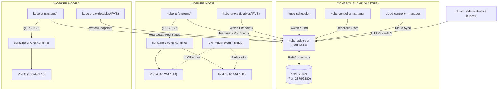
**Architectural Explanation:**  
The Kubernetes architecture divides cluster operations into the Control Plane and Worker Nodes. The `kube-apiserver` acts as the single central communications gateway; no component communicates directly with `etcd` other than the API server. Controllers and schedulers run continuously, watching the desired state via API server stream watches and reconciling reality to match. Worker nodes run `kubelet` (managing container lifecycles via CRI) and `kube-proxy` (programming network filter rules via iptables or IPVS).

---

## 2. Control Plane Component Inter-Communication
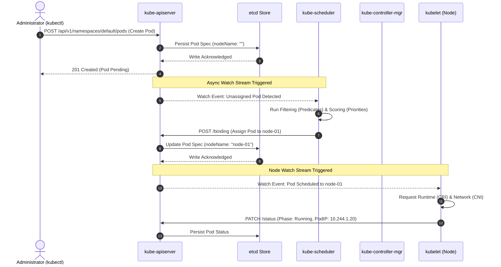
**Architectural Explanation:**  
All control-plane communication is asynchronous and mediated entirely by `kube-apiserver` watch streams. Neither the scheduler nor the kubelet poll; they maintain long-lived HTTP/2 streams watching specific API resource endpoints. When a scheduling decision is made, the scheduler writes a `/binding` subresource rather than mutating the Pod directly.

---

## 3. API Server Request Lifecycle
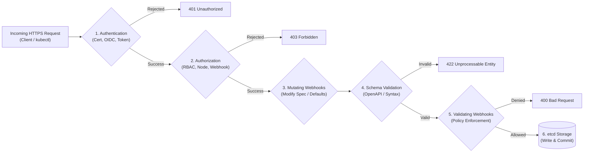
**Architectural Explanation:**  
Every API request traverses a deterministic 6-stage pipeline:
1. **Authentication (AuthN):** Resolves client identity to Username, UID, and Groups using Client Certificates (mTLS), Bearer Tokens (ServiceAccounts), or OIDC.
2. **Authorization (AuthZ):** Evaluates RBAC `Roles` and `ClusterRoles` using Rule Evaluation (Node authorizer checks kubelet rights).
3. **Mutating Admission Webhooks:** Injects defaults or modifies the specification (e.g., Istio sidecar injection).
4. **Object Schema Validation:** Verifies schema definitions against OpenAPI v3 specifications.
5. **Validating Admission Webhooks:** Enforces cluster-wide constraints without mutating (e.g., Gatekeeper, Kyverno).
6. **etcd Persistence:** Object state is committed to disk via Raft consensus.

---

## 4. etcd Raft Distributed Consensus & Leader Election
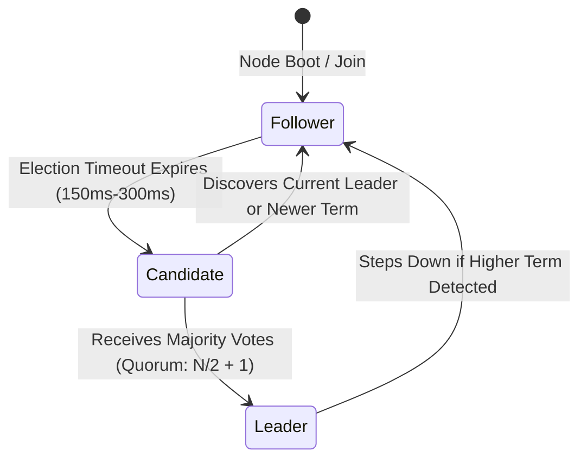
**Architectural Explanation:**  
etcd uses the Raft distributed consensus protocol. In an $N$-node cluster, a strict quorum of $\lfloor N/2 \rfloor + 1$ members is required to establish leadership and commit log entries:
* 3-node cluster: Quorum is 2 (tolerates 1 failure).
* 5-node cluster: Quorum is 3 (tolerates 2 failures).
If quorum is lost, etcd refuses all write requests to prevent split-brain state corruption.

---

## 5. etcd Quorum Loss & Multi-Member Disaster Recovery
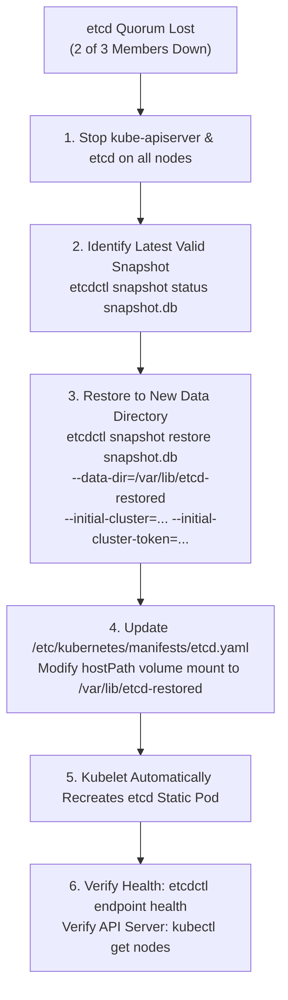
**Architectural Explanation:**  
When an etcd cluster experiences catastrophic failure, manual snapshot restoration is required. Restoring must always target a *new, non-existing directory* (`--data-dir=/var/lib/etcd-restored`) to prevent collision with corrupted wal files. The static pod manifest is then updated so kubelet restarts the container pointing to the clean database.

---

## 6. kube-scheduler Two-Phase Pipeline: Filtering & Scoring
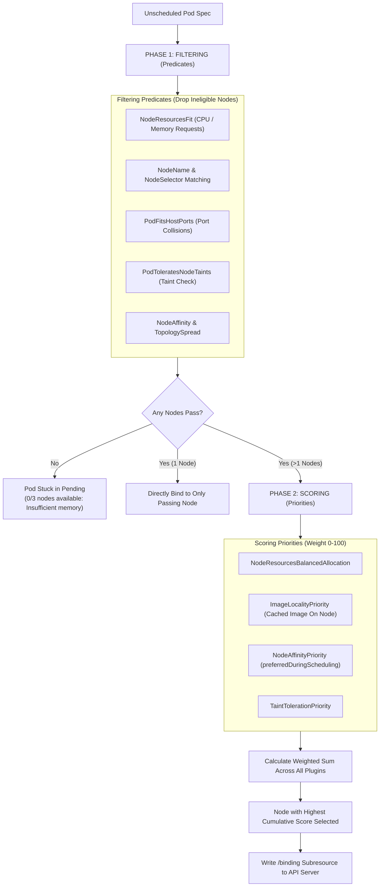
**Architectural Explanation:**  
Scheduling operates in two distinct phases:
1. **Filtering (Predicates):** Evaluates hard requirements. If a node fails even one predicate (insufficient RAM, untolerated taint), it is removed from consideration.
2. **Scoring (Priorities):** Evaluates soft preferences on surviving nodes, assigning scores from 0 to 100. Weights are applied, and the node with the highest aggregate score is chosen.

---

## 7. kube-controller-manager Reconciliation Loops
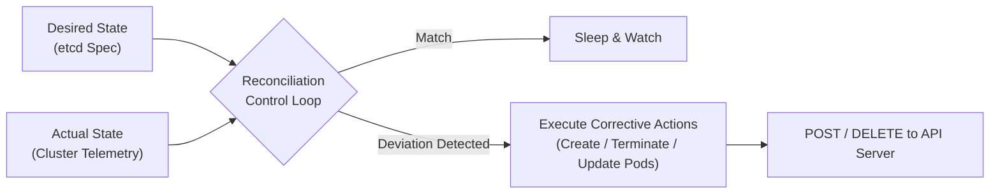
**Architectural Explanation:**  
Every Kubernetes controller runs an infinite control loop (`syncHandler`). It computes the diff $\Delta = \text{Desired State} - \text{Actual State}$. If replicas desired is 5 and actual is 3, the Deployment controller instructs the ReplicaSet controller to issue API requests creating 2 new Pods.

---

## 8. kubelet Internal Architecture
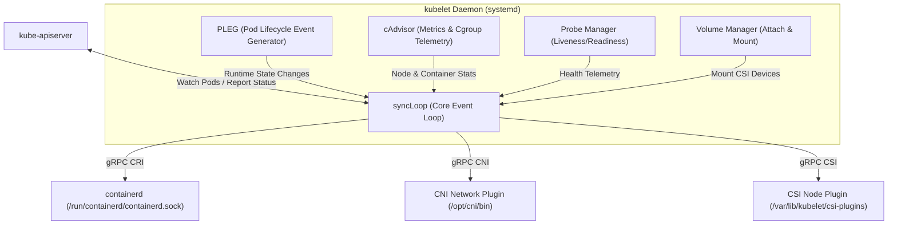
**Architectural Explanation:**  
The kubelet is the primary node agent. The `syncLoop` orchestrates updates based on events from:
* Pod manifests (from API server watch, static pod directory `/etc/kubernetes/manifests/`, or HTTP endpoints).
* PLEG (Pod Lifecycle Event Generator), which queries the container runtime via CRI to detect stopped or crashed containers.
* Probe Manager, which executes HTTP, TCP, exec, or gRPC probes.

---

## 9. containerd Architecture, shim-v2, and runc
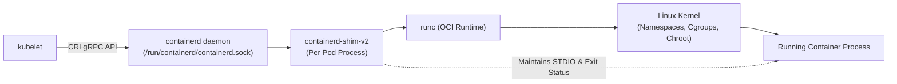
**Architectural Explanation:**  
`containerd` decouples pod execution from daemon restarts using `containerd-shim-v2`. When a container starts, `runc` initializes the Linux namespaces and cgroups, hands execution off to the containerized binary, and exits immediately. The lightweight shim stays alive as the container's parent process, holding open standard I/O pipes and capturing exit codes so `containerd` can restart without stopping running workloads.

---

## 10. Pod Lifecycle State Machine
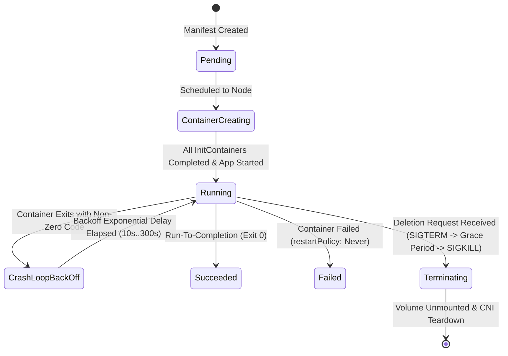
**Architectural Explanation:**  
A Pod progresses through strict phases. `CrashLoopBackOff` is not an official phase but a condition indicating repeated container termination. Kubernetes applies an exponential backoff delay (10s, 20s, 40s... capped at 300s) before re-attempting initialization.

---

## 11. Multi-Container Pod Design Patterns
```mermaid
graph TD
    subgraph Pod["Pod Network & IPC Namespace (Shared localhost)"]
        Init["Init Container<br/>(Runs to completion first)"]
        App["Main Application Container<br/>(Port 8080)"]
        Sidecar["Sidecar Container<br/>(Log Shipper / Envoy Proxy)"]
        SharedVol["Shared Volume (emptyDir)<br/>/var/log/app"]
    end

    Init -->|1. Setup Configuration & DB Schema| SharedVol
    App -->|2. Writes Application Logs| SharedVol
    Sidecar -->|3. Tails Logs & Streams to Cloud| SharedVol
    Sidecar <-->|Localhost Intercept (127.0.0.1:8080)| App
```
**Architectural Explanation:**  
Multi-container Pods share:
1. **Network Namespace:** Same IP address, port space, and `localhost` loopback interface.
2. **IPC Namespace:** Shared POSIX shared memory and semaphores.
3. **Mounted Volumes:** Containers share filesystem directories via `emptyDir` or shared PersistentVolumes.
Init containers run sequentially to full exit code `0` before the main application and sidecars start in parallel.

---

## 12. Deployment, ReplicaSet, and Pod Cascading Hierarchy
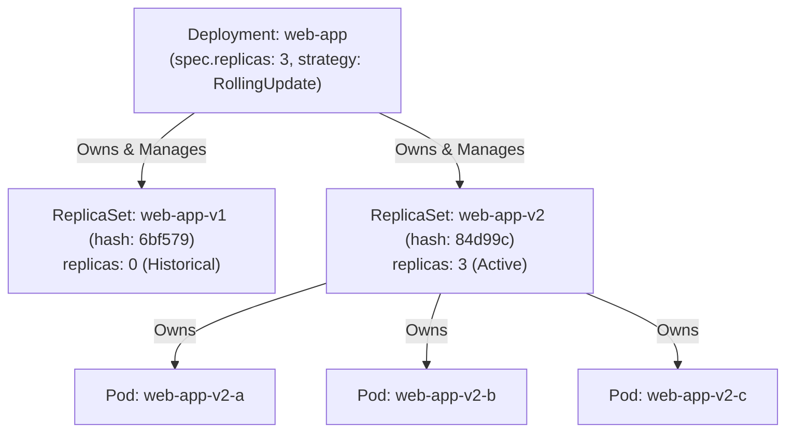
**Architectural Explanation:**  
Deployments do not create or manage Pods directly. A Deployment creates and manages `ReplicaSets` (identified by a 10-character pod-template-hash), and the ReplicaSets create and monitor the individual Pods. Rollbacks are executed simply by scaling up the old ReplicaSet while scaling down the current one.

---

## 13. Rolling Update Progression with maxSurge and maxUnavailable
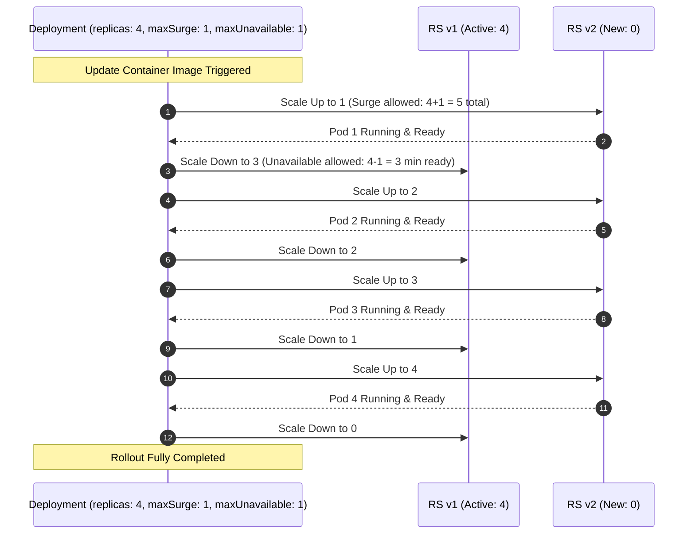
**Architectural Explanation:**  
Rolling updates preserve availability using two constraints:
* `maxSurge`: Maximum number of Pods that can be scheduled above the desired replica count.
* `maxUnavailable`: Maximum number of Pods that can be unavailable during the update.
During an update, new Pods must pass readiness probes before older Pods are scheduled for termination.

---

## 14. StatefulSet Stable Network Identity & Ordered Scaling
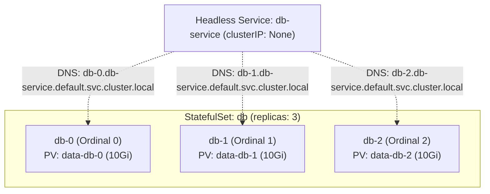
**Architectural Explanation:**  
StatefulSets provide:
1. **Deterministic Ordinals:** Pods are named `$(statefulset-name)-$(ordinal)` from 0 to $N-1$.
2. **Sequential Operations:** Pod $i$ must be Running and Ready before Pod $i+1$ is initialized. Scale-down occurs in reverse order.
3. **Persistent Volume Attachment:** Each replica receives an independent PersistentVolume via `volumeClaimTemplates` that persists across pod deletion.
4. **Stable Network Identity:** Paired with a Headless Service (`clusterIP: None`), each Pod receives a predictable DNS A-record.

---

## 15. DaemonSet Node Scheduling & Taint Tolerations
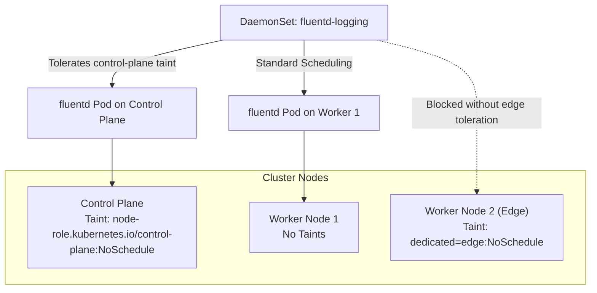
**Architectural Explanation:**  
A DaemonSet ensures that a copy of a Pod runs on all (or selected) nodes. By default, DaemonSet pods automatically include tolerations for standard node taints (`node.kubernetes.io/not-ready`, `unreachable`, `disk-pressure`). To run on control-plane nodes or specialized nodes with custom taints, explicit tolerations must be defined in the DaemonSet pod template.

---

## 16. Job & CronJob Execution Pipeline
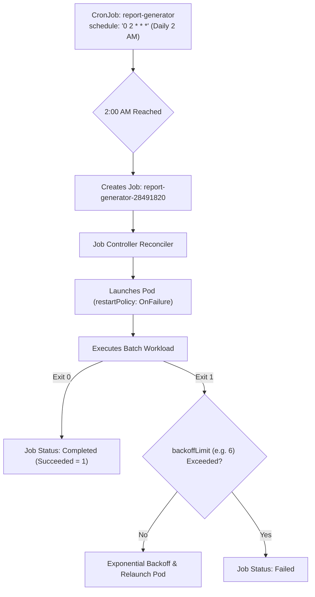
**Architectural Explanation:**  
CronJobs manage time-based execution by instantiating `Jobs`. Jobs guarantee batch run-to-completion. Unlike Deployments, Pods managed by a Job must declare `restartPolicy: OnFailure` or `Never`. If a container fails, the Job controller retries until `backoffLimit` is reached.

---

## 17. ConfigMap and Secret Injection Mechanics
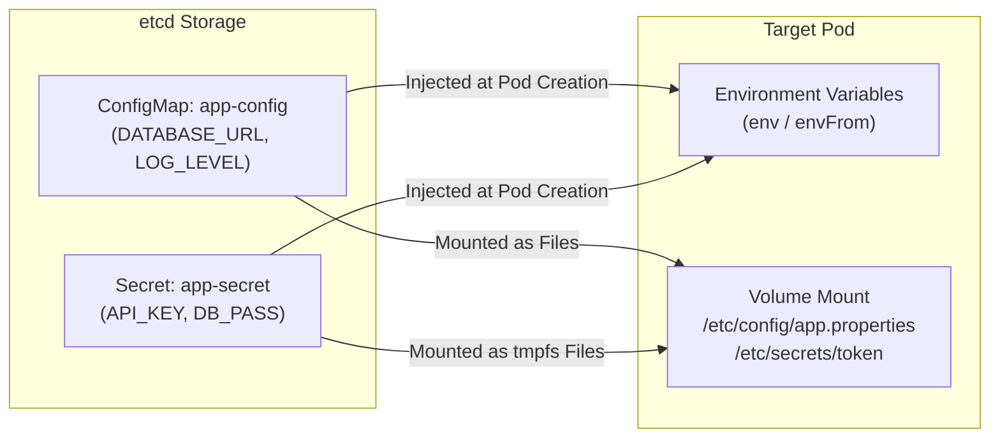
**Architectural Explanation:**  
ConfigMaps and Secrets can be consumed via:
1. **Environment Variables:** Values are evaluated at container creation. Modifying the ConfigMap *does not* update running environment variables without a pod restart.
2. **Volume Mounts:** Injected as files. Kubernetes atomic directory swapping ensures files are dynamically updated without restarting the pod (eventual consistency within kubelet sync periods). Secrets are stored in `tmpfs` (RAM) on the node to prevent disk persistence.

---

## 18. Resource Requests, Limits, and Kernel CFS Quotas
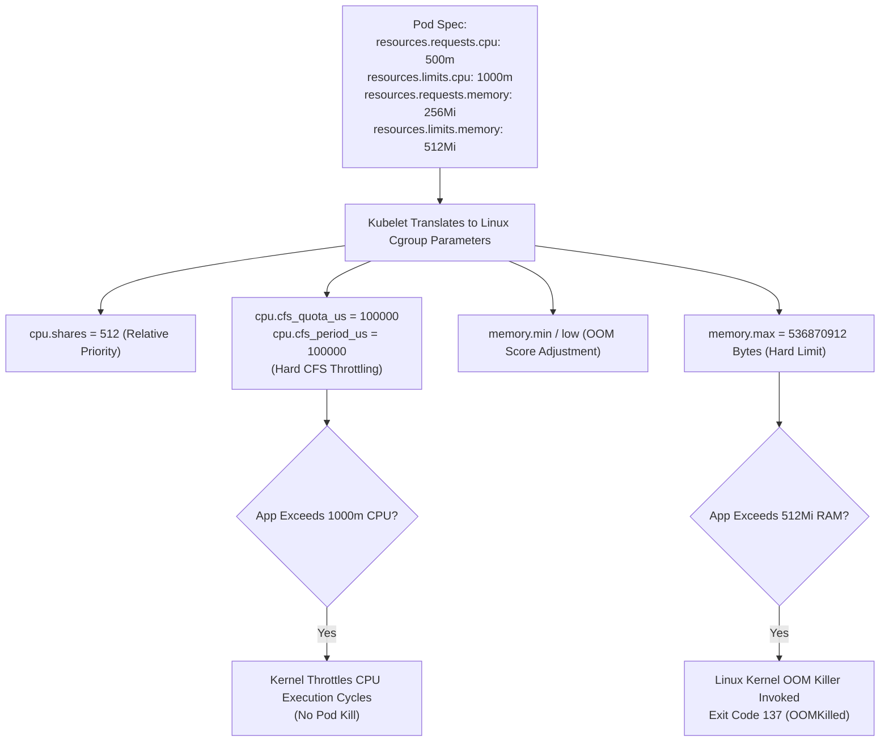
**Architectural Explanation:**  
* **CPU Requests:** Used by `kube-scheduler` for placement and translated to kernel `cpu.shares`.
* **CPU Limits:** Enforced via Completely Fair Scheduler (CFS) bandwidth quotas. Exceeding limits results in CPU cycle throttling, not termination.
* **Memory Requests:** Determines QoS class (`Guaranteed`, `Burstable`, `BestEffort`) and OOM-score adjustment.
* **Memory Limits:** Enforced as a hard memory ceiling. Exceeding memory limits triggers an instantaneous kernel `OOMKilled` (Exit Code 137).

---

## 19. Liveness, Readiness, and Startup Probe Execution Lifecycle
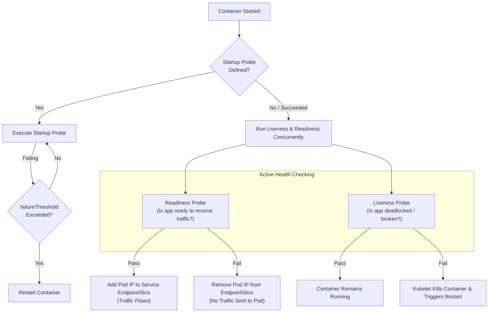
**Architectural Explanation:**  
1. **Startup Probe:** Disables liveness and readiness checks during slow initialization. If it fails, the container is killed.
2. **Readiness Probe:** Controls service routing. A failed readiness probe removes the Pod from Service `EndpointSlices` without killing the container.
3. **Liveness Probe:** Detects deadlocks and internal application halts. A failed liveness probe triggers an immediate container restart by the kubelet.

---

## 20. Node Affinity, Anti-Affinity, and Topology Spread Constraints
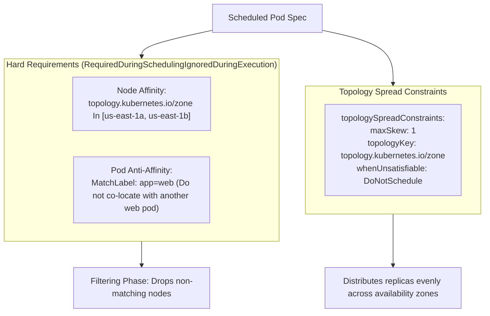
**Architectural Explanation:**  
* `requiredDuringSchedulingIgnoredDuringExecution`: Strict rule. If no node matches, the Pod remains `Pending`.
* `preferredDuringSchedulingIgnoredDuringExecution`: Soft rule used during the scoring phase.
* `topologySpreadConstraints`: Ensures high availability by preventing pods from concentrating in a single failure domain (zone, rack, or host), strictly bounding skew by `maxSkew`.

---

## 21. Taints, Tolerations, and Node Cordon/Drain Eviction
```mermaid
sequenceDiagram
    autonumber
    actor Admin as Administrator
    participant API as kube-apiserver
    participant Node as Worker Node (node-02)
    participant Pods as Workload Pods

    Admin->>API: kubectl cordon node-02
    API->>Node: Mark unschedulable (node.spec.unschedulable = true)
    Note over Node: No new pods will be scheduled on node-02

    Admin->>API: kubectl drain node-02 --ignore-daemonsets --delete-emptydir-data
    API->>Pods: Send Eviction API request to each Pod on node-02
    Note over API: Respects PodDisruptionBudgets (PDB)
    Pods->>Pods: Receive SIGTERM & Graceful Shutdown (30s)
    API->>Node: Delete Pods from node-02
    Note over API: Deployment Controller reschedules replacement Pods on other nodes

    Admin->>Node: Perform OS Patching / Kubelet Upgrade / Reboot
    Admin->>API: kubectl uncordon node-02
    API->>Node: Mark schedulable (node.spec.unschedulable = false)
```
**Architectural Explanation:**  
* **Taints:** Applied to nodes (`key=value:Effect`). Effects include `NoSchedule`, `PreferNoSchedule`, and `NoExecute`.
* **Tolerations:** Declared on Pods to allow scheduling on tainted nodes.
* **Cordoning:** Marks a node unschedulable without disturbing running pods.
* **Draining:** Safely evicts running pods via the Eviction API (honoring PDBs) so the host can undergo maintenance.

---

## 22. Pod Priority, PriorityClasses, and Preemption
```mermaid
flowchart TD
    HighPod["Incoming High-Priority Pod<br/>(priorityClassName: production-critical, Value: 1000000)"] --> Sched["kube-scheduler Evaluates Nodes"]
    Sched --> FitCheck{"Can Pod fit on any node<br/>without changes?"}
    FitCheck -- Yes --> ScheduleStandard["Schedule Normally"]
    FitCheck -- No --> Preemption["PREEMPTION ALGORITHM TRIGGERED"]

    Preemption --> ScanNodes["Scan nodes for lower-priority pods"]
    ScanNodes --> SelectVictims["Select lowest-priority victim pods<br/>(priorityClassName: batch-low, Value: 100)"]
    SelectVictims --> EvictVictim["Send Eviction / Delete to Victim Pods"]
    EvictVictim --> WaitGrace["Wait for termination grace period"]
    WaitGrace --> BindHigh["Bind High-Priority Pod to Freed Node Capacity"]
```
**Architectural Explanation:**  
When high-priority workloads cannot be scheduled due to insufficient resources, the scheduler's preemption logic evicts lower-priority pods. The scheduler sets `nominatedNodeName` on the high-priority pod while waiting for the victims to terminate cleanly.

---

## 23. Horizontal Pod Autoscaler (HPA) Metrics Flow
```mermaid
sequenceDiagram
    autonumber
    participant App as Pods (App Replicas)
    participant cAd as cAdvisor (Node Kubelet)
    participant MS as metrics-server
    participant HPA as HPA Controller
    participant Dep as Deployment Controller

    App->>cAd: Execute Workload (CPU/Memory Consumption)
    cAd->>cAd: Aggregate Cgroup Telemetry
    MS->>cAd: Scrape Summary API (/stats/summary) every 15s
    HPA->>MS: Query Metrics API (metrics.k8s.io/v1beta1) every 15s
    Note over HPA: Compute Formula:<br/>desiredReplicas = ceil[currentReplicas * (currentMetric / targetMetric)]
    HPA->>Dep: Update Scale Subresource (e.g. Scale 2 -> 5 Replicas)
    Dep->>App: Spawn Additional Pods
```
**Architectural Explanation:**  
The HPA controller queries the `metrics.k8s.io` API provided by `metrics-server`. It computes the target scale using the formula:
$$\text{desiredReplicas} = \left\lceil \text{currentReplicas} \times \left( \frac{\text{currentMetricValue}}{\text{targetMetricValue}} \right) \right\rceil$$
Stabilization windows prevent rapid thrashing (flapping) during metric spikes.

---

## 24. ResourceQuota and LimitRange Admission Controller
```mermaid
flowchart LR
    CreateReq["kubectl create Pod Spec<br/>(cpu: 500m, memory: 1Gi)"] --> LR{"LimitRange Admission Check"}
    
    subgraph LimitRangeRules["LimitRange (Per Pod/Container Defaults & Bounds)"]
        LR1["Inject default requests/limits if missing"]
        LR2["Enforce min/max allowed per container"]
    end

    LR --> LimitRangeRules
    LimitRangeRules -- Violates Bounds --> RejectLR["403 Forbidden: LimitRange Exceeded"]
    LimitRangeRules -- Passes --> RQ{"ResourceQuota Admission Check"}

    subgraph ResourceQuotaRules["ResourceQuota (Namespace Aggregate Capacity)"]
        RQ1["Sum current allocated requests + new request"]
        RQ2["Compare against hard quota ceiling"]
    end

    RQ --> ResourceQuotaRules
    ResourceQuotaRules -- Exceeds Aggregate --> RejectRQ["403 Forbidden: Exceeded Quota"]
    ResourceQuotaRules -- Under Ceiling --> Allow["Commit Pod to etcd"]
```
**Architectural Explanation:**  
* **LimitRange:** Enforces constraints on individual Pods/containers within a namespace (min/max bounds and automatic default injection).
* **ResourceQuota:** Enforces aggregate limits on total resources (CPU, Memory, Pod count, PVC count) consumed across the entire namespace.

---

## 25. Kubernetes Networking: Intra-Node vs. Inter-Node Packet Flow
```mermaid
flowchart TD
    subgraph Node1["WORKER NODE 1 (192.168.1.10)"]
        PodA["Pod A<br/>10.244.1.5"] <-->|veth pair| Bridge1["cbr0 / CNI Bridge"]
        PodB["Pod B<br/>10.244.1.6"] <-->|veth pair| Bridge1
        Bridge1 <-->|Host Route| VXLAN1["VXLAN Tunnel Interface (flannel.1 / calico)"]
    end

    subgraph Node2["WORKER NODE 2 (192.168.1.20)"]
        PodC["Pod C<br/>10.244.2.8"] <-->|veth pair| Bridge2["cbr0 / CNI Bridge"]
        Bridge2 <-->|Host Route| VXLAN2["VXLAN Tunnel Interface (flannel.1 / calico)"]
    end

    PodA -.->|Intra-Node: Local Bridge Switching| PodB
    VXLAN1 == Encapsulated UDP Packet (Port 4789 / 8472) ==> VXLAN2
    VXLAN2 -->|Decapsulate| PodC
```
**Architectural Explanation:**  
1. **Intra-Node:** Traffic between Pod A and Pod B stays entirely on the local Linux bridge (`cbr0` or veth pair). No encapsulation or external routing occurs.
2. **Inter-Node:** Traffic destined for Pod C (different subnet `10.244.2.0/24`) is routed to the overlay interface (e.g., `flannel.1`), encapsulated inside an outer UDP packet, transmitted across the physical network, and decapsulated by the destination node's CNI interface.

---

## 26. Kubernetes Service Routing: iptables vs. IPVS
```mermaid
graph TD
    Client["Client Pod (10.244.1.5)"] -->|Connects to Service ClusterIP 10.96.0.100:80| Kernel["Linux Kernel Netfilter"]

    subgraph Mode["kube-proxy Mode"]
        IPTables["iptables Mode (Sequential Chains)<br/>PREROUTING -> KUBE-SERVICES -> KUBE-SVC-XXX<br/>Random probability load balancing: 1/n"]
        IPVS["IPVS Mode (Kernel Hash Tables)<br/>Netlink IPVS Virtual Server (10.96.0.100:80)<br/>Algorithms: Round-Robin, Least-Connection, Source-Hash"]
    end

    Kernel --> Mode
    Mode --> DNAT["DNAT: Translate ClusterIP to Endpoint Pod IP (10.244.2.15:8080)"]
    DNAT --> TargetPod["Target Pod (10.244.2.15)"]
```
**Architectural Explanation:**  
Services do not run as processes; they are virtual IPs programmed by `kube-proxy`.
* **iptables:** Uses sequentially evaluated packet filter chains. Rules grow $O(N)$ with service counts, introducing latency at scale.
* **IPVS:** Uses kernel hash tables offering $O(1)$ lookups, supporting large-scale enterprise deployments with granular load-balancing algorithms.

---

## 27. EndpointSlice Architecture
```mermaid
graph TD
    Svc["Service: api-service<br/>(ClusterIP: 10.96.10.50)"]
    
    subgraph Traditional["Legacy Endpoints (Single Monolithic Object)"]
        EP["Endpoints: api-service<br/>Contains 5,000 Pod IPs<br/>(1.5MB etcd object updated on ANY pod change)"]
    end

    subgraph Modern["EndpointSlices (Scalable Partitioning)"]
        EPS1["EndpointSlice: api-service-1<br/>Endpoints 1 to 100"]
        EPS2["EndpointSlice: api-service-2<br/>Endpoints 101 to 200"]
        EPS3["EndpointSlice: api-service-N<br/>Endpoints N to N+100"]
    end

    Svc --> Traditional
    Svc --> Modern
```
**Architectural Explanation:**  
Legacy `Endpoints` stored all backing pod IPs in a single API resource. For a service with 2,000 replicas, a single pod scaling event forced the API server and all kube-proxy instances to re-transmit the entire multi-megabyte object. `EndpointSlices` partition endpoints into chunks of 100, dramatically reducing control-plane bandwidth and CPU load.

---

## 28. Cluster DNS Resolution: CoreDNS
```mermaid
sequenceDiagram
    autonumber
    participant Pod as Application Pod
    participant CoreDNS as CoreDNS (10.96.0.10)
    participant Upstream as External Upstream DNS (8.8.8.8)

    Note over Pod: Read /etc/resolv.conf<br/>nameserver 10.96.0.10<br/>search default.svc.cluster.local svc.cluster.local cluster.local
    Pod->>CoreDNS: Query: backend-svc (Appends default.svc.cluster.local)
    CoreDNS->>CoreDNS: Match in-memory Service cache
    CoreDNS-->>Pod: Return Service ClusterIP (10.96.40.22)

    Pod->>CoreDNS: Query: external.example.com
    CoreDNS->>CoreDNS: Does not match cluster.local zone
    CoreDNS->>Upstream: Forward DNS Query to 8.8.8.8
    Upstream-->>CoreDNS: Return Public IP (93.184.216.34)
    CoreDNS-->>Pod: Return Public IP
```
**Architectural Explanation:**  
Every Pod inherits `/etc/resolv.conf` configured with `nameserver 10.96.0.10` (CoreDNS Service IP) and search paths. Queries for bare names (`backend-svc`) sequentially append search domains until a match is resolved by CoreDNS. External domains are forwarded upstream to host resolvers.

---

## 29. Ingress Controller Architecture
```mermaid
graph TD
    Client["External Client (HTTPS:443)"] --> LB["External Load Balancer"]
    LB --> NodePort["NodePort 30443 (Worker Nodes)"]
    NodePort --> IngressPod["Ingress Controller Pod (nginx / traefik)"]
    
    subgraph Rules["Ingress Resource (networking.k8s.io/v1)"]
        R1["Host: api.example.com /path: /v1 -> Service api-svc:8080"]
        R2["Host: web.example.com /path: /   -> Service web-svc:80"]
    end

    IngressPod --> Rules
    Rules --> PodA["api-svc Pod (10.244.1.15)"]
    Rules --> PodB["web-svc Pod (10.244.2.22)"]
```
**Architectural Explanation:**  
An Ingress Controller is a specialized reverse proxy running inside the cluster. It bypasses `kube-proxy` ClusterIP routing for performance, querying `EndpointSlices` directly to stream traffic straight to container endpoints with TLS termination and path rewrites.

---

## 30. Gateway API Architecture & Role Separation
```mermaid
graph TD
    subgraph InfraProvider["Infrastructure Provider"]
        GC["GatewayClass: standard-gateway<br/>(controller: acme.io/gateway-controller)"]
    end

    subgraph ClusterAdmin["Cluster Administrator"]
        GW["Gateway: prod-gateway<br/>(Listeners: HTTPS:443, Host: *.example.com)"]
    end

    subgraph AppDeveloper["Application Developer (Namespaces)"]
        HR1["HTTPRoute: payments-route<br/>(ParentRef: prod-gateway, Path: /payments)"]
        HR2["HTTPRoute: orders-route<br/>(ParentRef: prod-gateway, Path: /orders)"]
        Svc1["Service: payments-svc"]
        Svc2["Service: orders-svc"]
    end

    GC -->|Defines Controller| GW
    GW -->|Attached By| HR1
    GW -->|Attached By| HR2
    HR1 --> Svc1
    HR2 --> Svc2
```
**Architectural Explanation:**  
Gateway API succeeds Ingress by splitting routing into three decoupled personas:
1. **Infrastructure Provider (`GatewayClass`):** Defines the underlying load-balancing implementation.
2. **Cluster Administrator (`Gateway`):** Declares network ports, IP allocations, and TLS certificates.
3. **Application Developer (`HTTPRoute`):** Defines routing rules, header matches, and canary weights without needing cluster-admin privileges.

---

## 31. NetworkPolicy Traffic Filtering Matrix
```mermaid
graph LR
    subgraph External["Traffic Sources"]
        World["Internet / Outside Cluster"]
        OtherNS["Pods in Other Namespaces"]
        SameNS["Pods in Same Namespace"]
    end

    subgraph Target["Target Pod (app: secure-db, port: 5432)"]
        NetPol["NetworkPolicy Enforcement<br/>policyTypes: [Ingress, Egress]"]
        DBPod["Postgres Container (5432)"]
    end

    World -- Blocked by Default Deny --> NetPol
    OtherNS -- Allowed if namespaceSelector Matches --> NetPol
    SameNS -- Allowed if podSelector Matches app: backend --> NetPol
    NetPol --> DBPod
```
**Architectural Explanation:**  
* By default, all Pod network traffic is **non-isolated** (open allow-all).
* The moment a `NetworkPolicy` selects a Pod, it transitions to **default-deny** for that policy type (Ingress or Egress).
* Traffic is whitelisted only when source criteria (podSelector, namespaceSelector, ipBlock) and destination port match explicitly.

---

## 32. CSI Architecture and Volume Mount Protocol
```mermaid
sequenceDiagram
    autonumber
    participant API as kube-apiserver
    participant Attacher as CSI External Attacher
    participant Provisioner as CSI External Provisioner
    participant Kube as Node Kubelet
    participant Driver as CSI Node Plugin

    API->>Provisioner: Create PVC with StorageClass
    Provisioner->>Provisioner: Provision Remote Storage Disk (e.g. AWS EBS / Ceph)
    Provisioner->>API: Create PersistentVolume (PV) bound to PVC

    API->>Attacher: Pod Scheduled to node-01
    Attacher->>Attacher: Call ControllerPublishVolume (Attach Disk to VM)
    Attacher->>API: Update VolumeAttachment Status (Attached)

    API->>Kube: VolumeAttachment Ready for Mount
    Kube->>Driver: NodeStageVolume (Format filesystem e.g. ext4)
    Kube->>Driver: NodePublishVolume (Bind mount to /var/lib/kubelet/pods/UID/volumes)
    Kube->>Kube: Launch Container with Mounted Filesystem
```
**Architectural Explanation:**  
Container Storage Interface (CSI) separates storage plugins from core Kubernetes code:
1. **Controller Plugins:** Run on control plane (`csi-provisioner`, `csi-attacher`) to provision and attach block devices to nodes.
2. **Node Plugins:** Run as DaemonSets on worker nodes (`csi-node-driver-registrar`) to execute local format (`NodeStageVolume`) and mount (`NodePublishVolume`) calls.
