# VOLUME III: THE KUBERNETES VISUAL ARCHITECTURE ATLAS
## PART 2: SYSTEMATIC TROUBLESHOOTING DECISION TREES (DIAGRAMS 33–64)

---

## 33. Universal 60-Second Node Triage Decision Tree
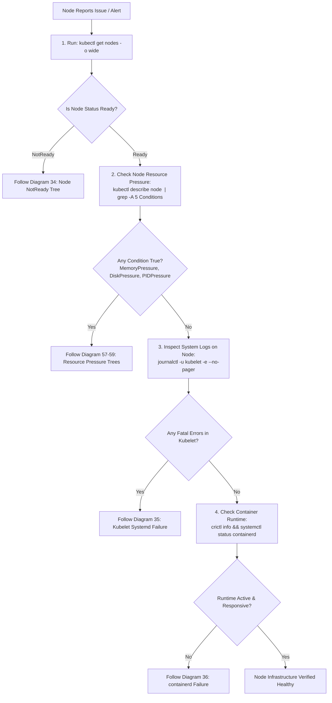
**Diagnostic Explanation:**  
When troubleshooting an affected cluster, never jump blindly into pod manifests. Follow this 60-second triage protocol to isolate node-level infrastructure failures from workload application faults in under one minute.

---

## 34. Node Status: NotReady Diagnostic and Remediation Algorithm
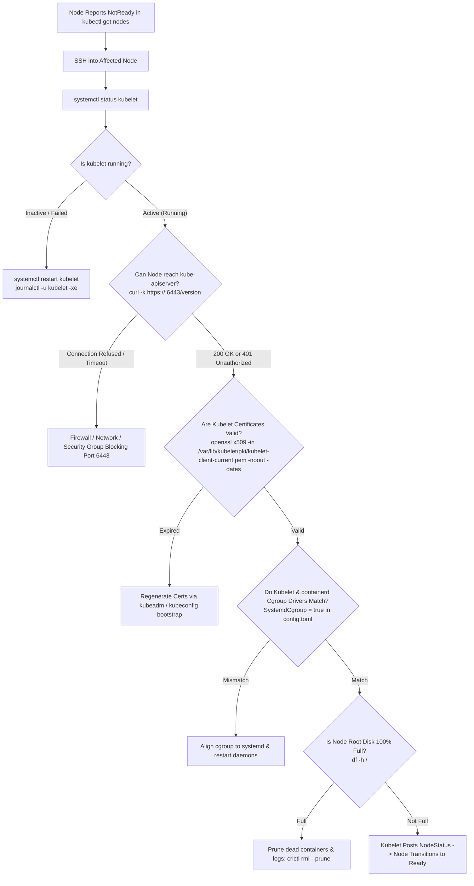
**Diagnostic Explanation:**  
A `NotReady` condition occurs when the node lease fails to renew or heartbeat times out. Root causes fall into:
1. Dead `kubelet` systemd service.
2. Network partition to the API server on port 6443.
3. Expired TLS client certificates in `/var/lib/kubelet/pki/`.
4. Cgroup driver mismatch between kubelet and containerd.
5. Disk space exhaustion preventing container creation.

---

## 35. kubelet Systemd Service Failure & Cgroup Driver Mismatch
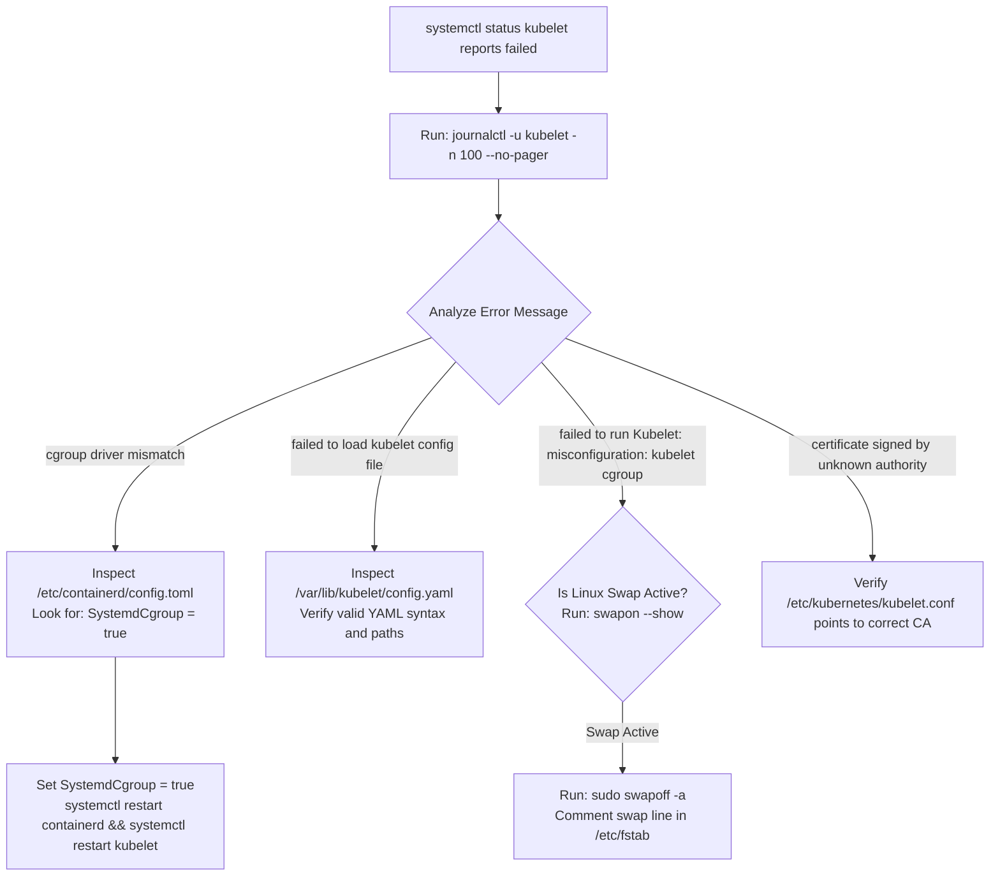
**Diagnostic Explanation:**  
The kubelet will refuse to start if Linux swap memory is enabled (unless configured explicitly with `failSwapOn: false`) or if the cgroup driver does not match the container runtime (`systemd` is mandatory in modern Kubernetes).

---

## 36. Container Runtime (containerd) Socket and CRI Resolution
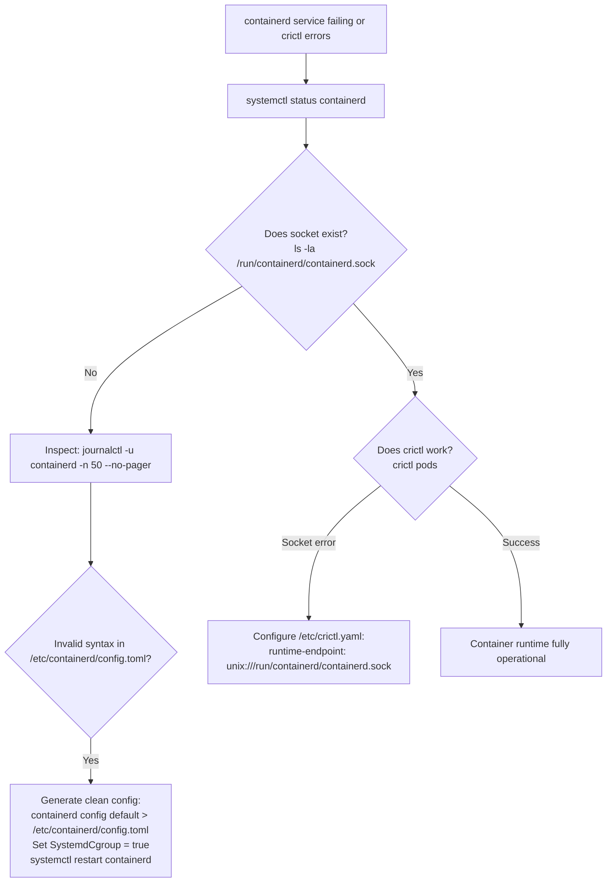
**Diagnostic Explanation:**  
`crictl` requires an explicit runtime endpoint configuration. If `/etc/crictl.yaml` is absent, run `crictl config --set runtime-endpoint=unix:///run/containerd/containerd.sock`. Corrupted `config.toml` files should be regenerated from `containerd config default`.

---

## 37. Control Plane Static Pod Outage & Log Recovery
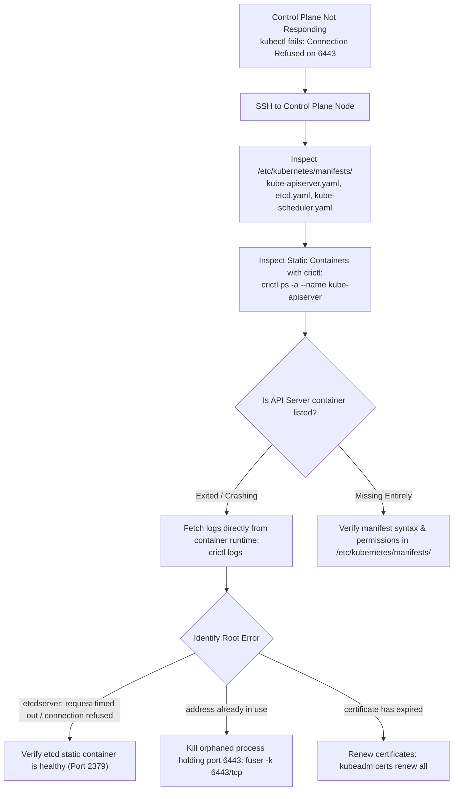
**Diagnostic Explanation:**  
When the API server is down, `kubectl` cannot be used. Troubleshooting must be conducted on the control-plane host using `crictl ps -a` and inspecting raw static pod container logs directly under `/var/log/pods/` or via `crictl logs`.

---

## 38. kube-apiserver Port 6443 Connection Refused Resolution
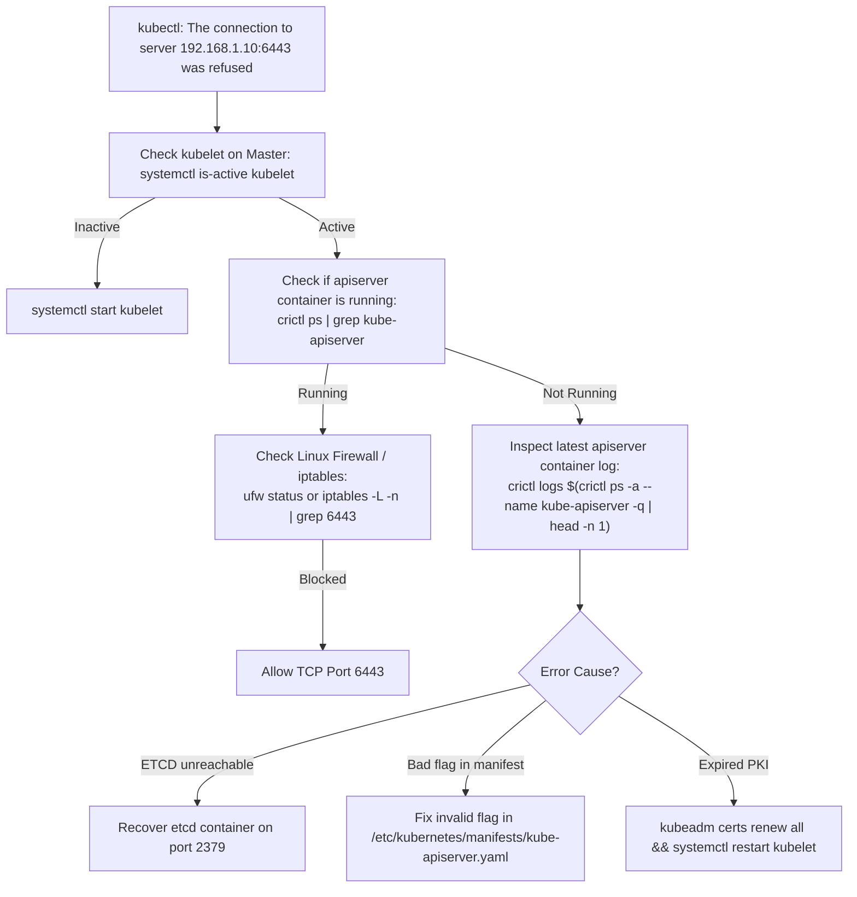
**Diagnostic Explanation:**  
"Connection refused" on port 6443 means no process is listening on the port. It is almost always caused by the `kube-apiserver` static pod crashing on startup due to etcd connection failure or bad arguments in `/etc/kubernetes/manifests/kube-apiserver.yaml`.

---

## 39. etcd Cluster Health, Cert Expiration & Quorum Restoration
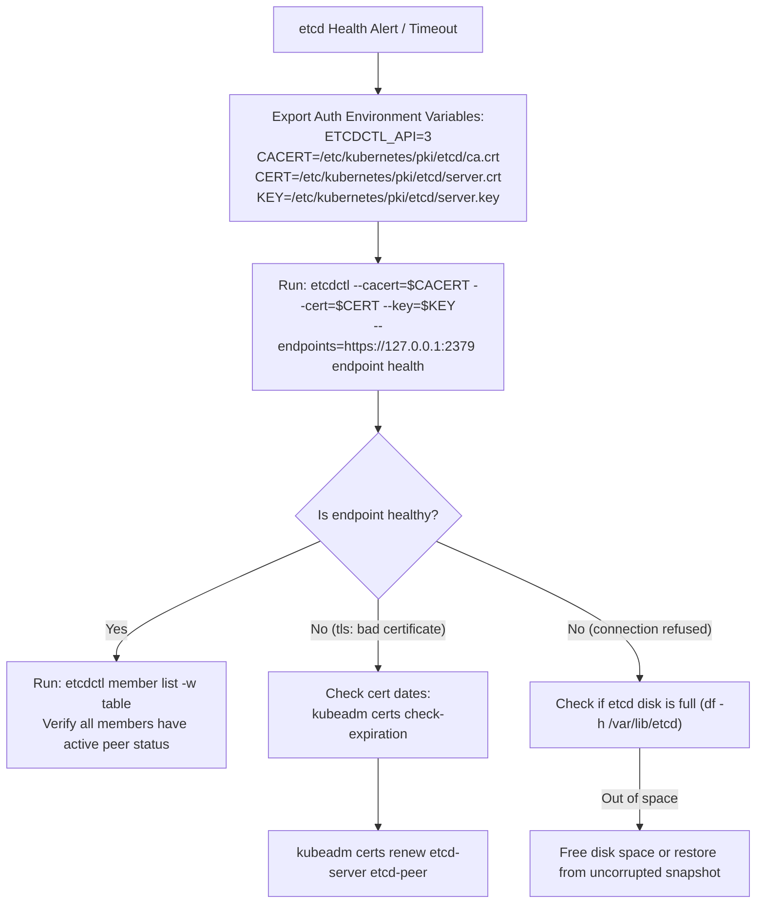
**Diagnostic Explanation:**  
All `etcdctl` commands in Kubernetes require mTLS authentication using `/etc/kubernetes/pki/etcd/server.crt` and `server.key`. Always verify cluster health before attempting snapshot restores.

---

## 40. CoreDNS Resolution Failure & Loop Detection Diagnostic Tree
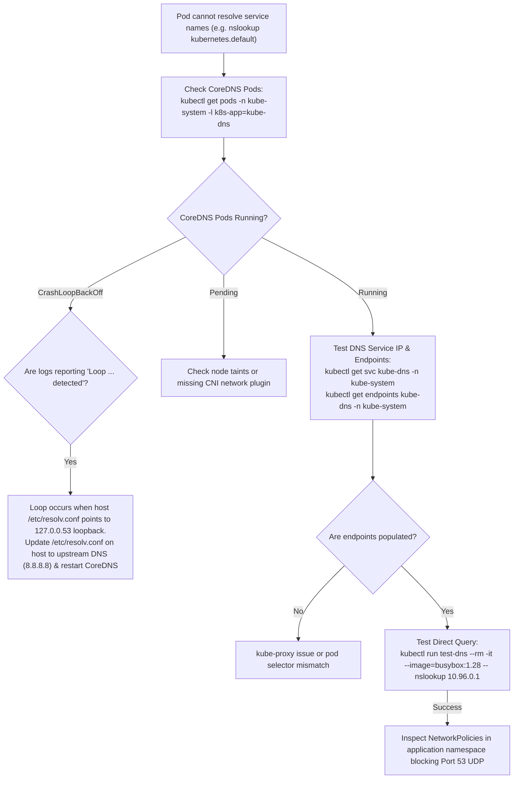
**Diagnostic Explanation:**  
CoreDNS CrashLoopBackOff with `Loop detected` is a classic Linux systemd-resolved bug where CoreDNS forwards to local loopback and detects infinite recursion. The fix is updating host nameservers and editing the `Corefile` in `ConfigMap/coredns`.

---

## 41. Pod Stuck in Pending: Scheduling Failure Flowchart
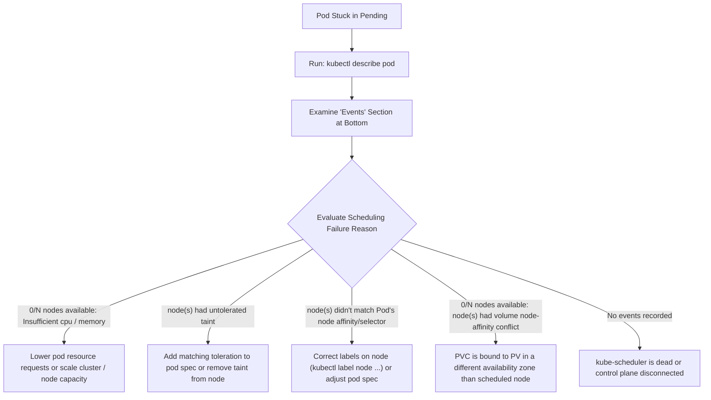
**Diagnostic Explanation:**  
If a Pod is `Pending`, the `kube-scheduler` has failed to bind it to a node. The `Events` table of `kubectl describe pod` lists the exact predicate that failed on every node.

---

## 42. Pod CrashLoopBackOff: Exit Code Analysis
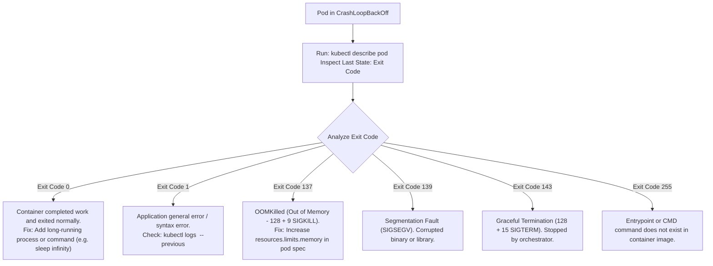
**Diagnostic Explanation:**  
Exit codes convey the precise termination cause:
* Exit Code 0: Task finished (Jobs use this; long-running services crash without a persistent foreground daemon).
* Exit Code 137: Memory limit exceeded (OOMKilled) or external `kill -9`.
* Always run `kubectl logs <pod-name> --previous` to see what printed immediately before the crash.

---

## 43. ImagePullBackOff & Private Registry Credential Failure
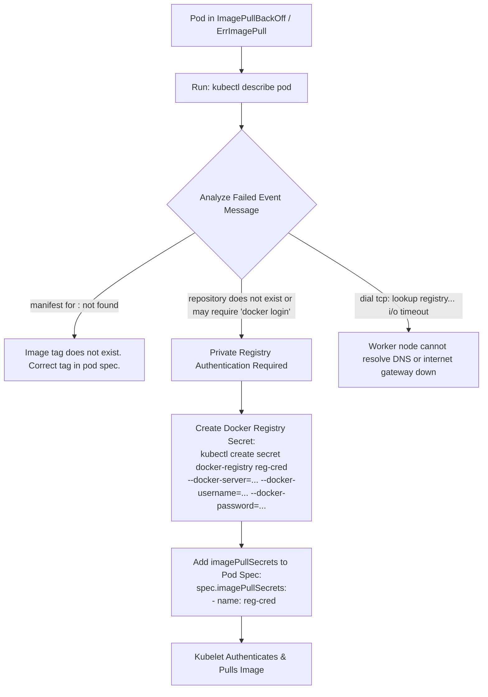
**Diagnostic Explanation:**  
`ImagePullBackOff` indicates that the container image cannot be downloaded. Ensure the image tag is exact and that `imagePullSecrets` are defined in the pod manifest or bound to the ServiceAccount.

---

## 44. CreateContainerConfigError & Missing ConfigMap/Secret
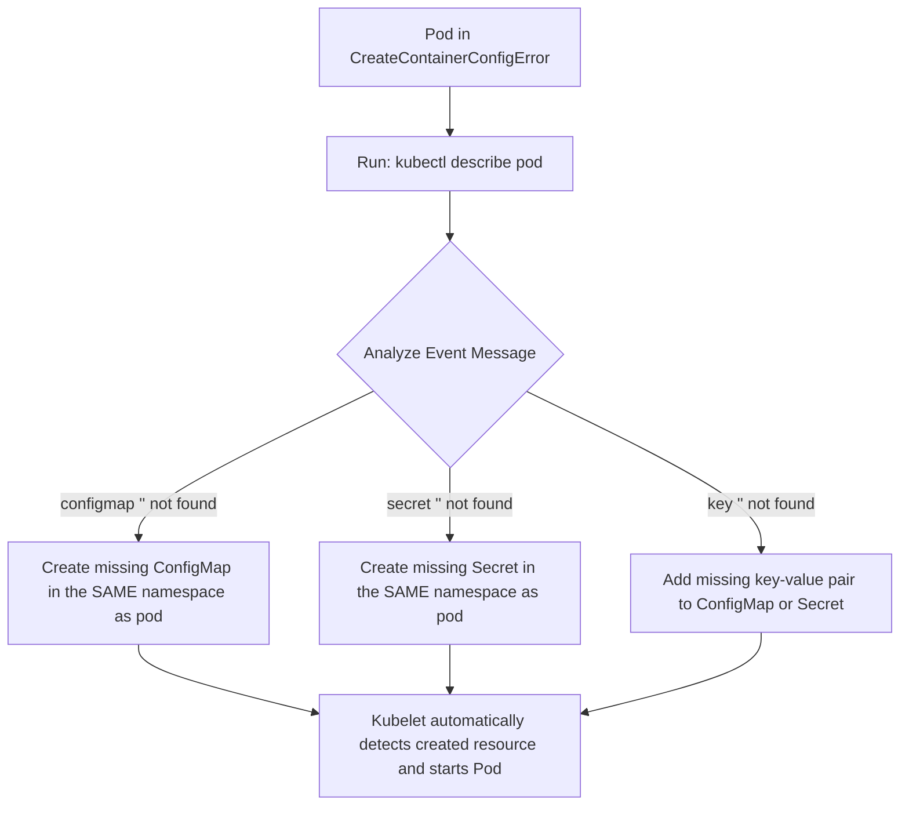
**Diagnostic Explanation:**  
`CreateContainerConfigError` occurs before the container process is launched because a referenced `configMapKeyRef` or `secretKeyRef` does not exist in the pod's namespace. The pod transitions to `Running` automatically once the missing resource is created.

---

## 45. Service Connectivity Failure: ClusterIP Unreachable
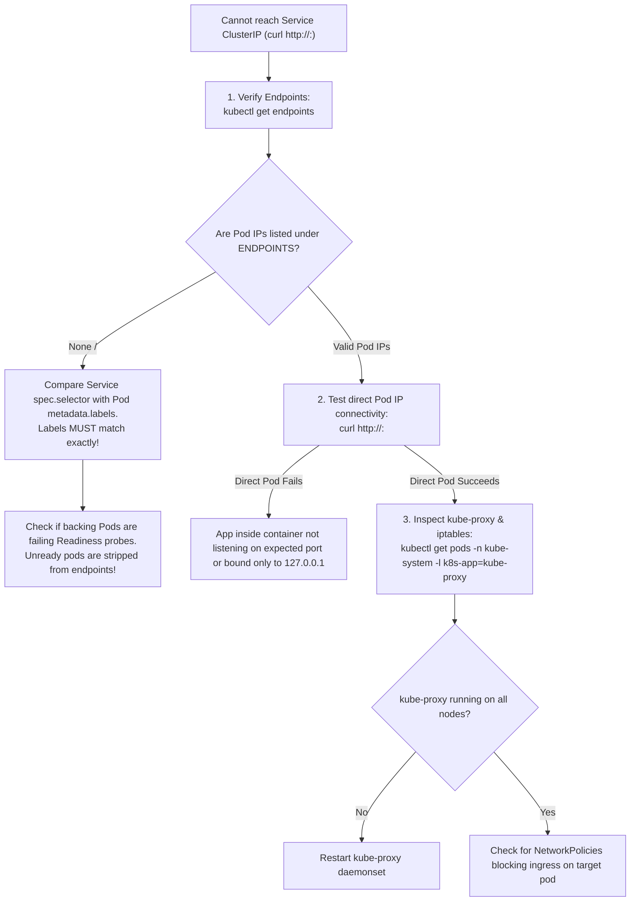
**Diagnostic Explanation:**  
A healthy Service requires:
1. Exact label selector matching pod labels.
2. Backing pods passing readiness probes.
3. Target container listening on `0.0.0.0` (not `127.0.0.1`).
4. Active `kube-proxy` iptables/IPVS rules on every node.

---

## 46. NodePort Service Port Refused & Firewall Mismatch
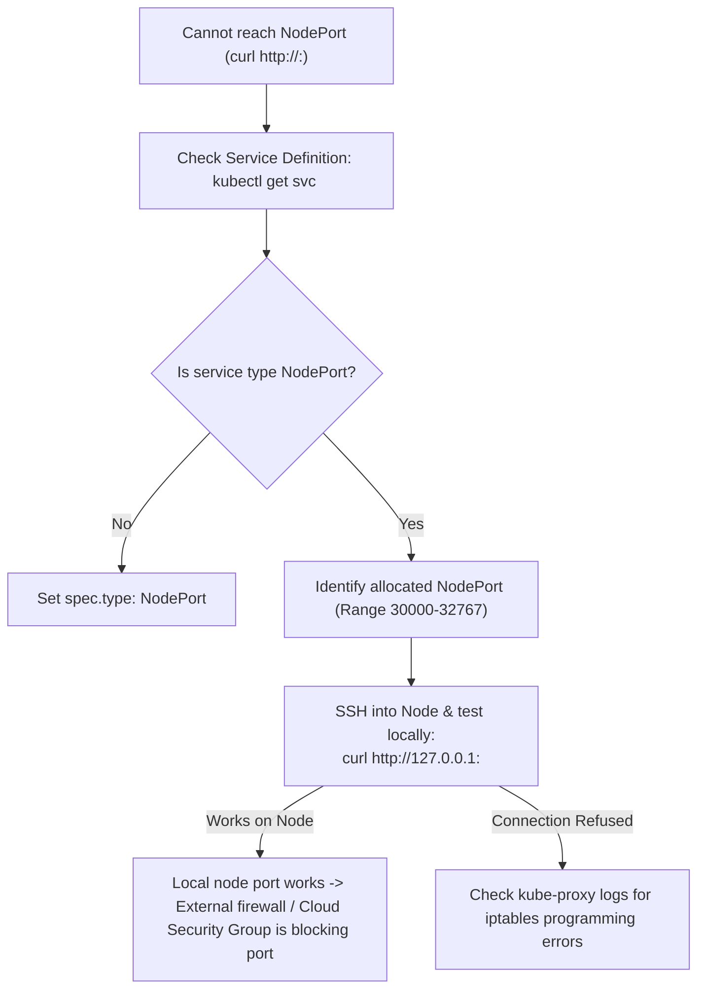
**Diagnostic Explanation:**  
If a NodePort works via `curl http://127.0.0.1:<port>` on the node itself but fails from outside, the host firewall (`ufw`, `firewalld`) or cloud security group is blocking the port range 30000–32767.

---

## 47. Ingress 404 Not Found & 502/503 Bad Gateway
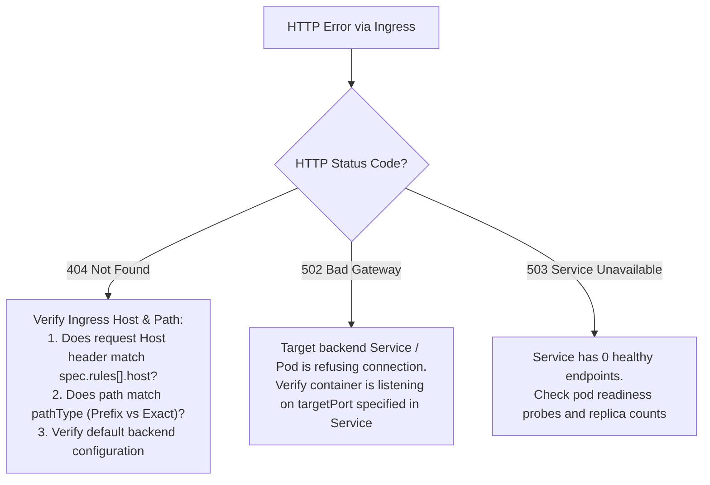
**Diagnostic Explanation:**  
* **404 Not Found:** Ingress controller received the request, but no rule matched the `Host` or `Path`.
* **502 Bad Gateway:** Ingress routed traffic to the upstream pod, but the pod refused the TCP connection (port mismatch).
* **503 Service Unavailable:** No backing pods are in `Ready` state.

---

## 48. Gateway API HTTPRoute Detached & Unresolved ParentRef
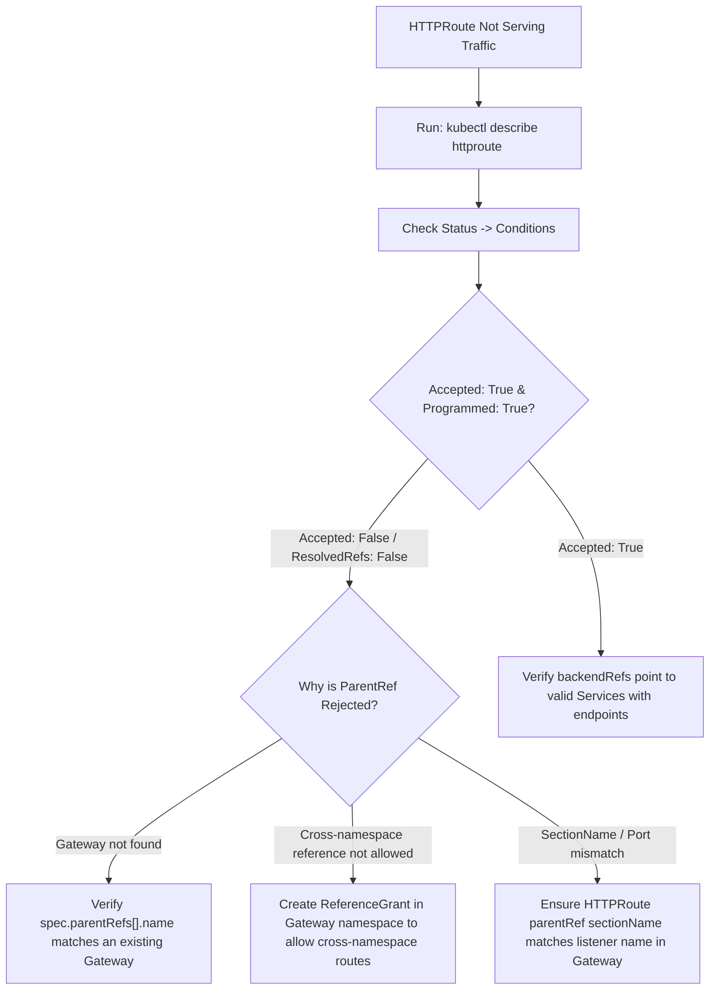
**Diagnostic Explanation:**  
Gateway API routes decouple routing from gateways. An `HTTPRoute` must be accepted by the parent `Gateway`. If they reside in different namespaces, a `ReferenceGrant` resource is mandatory for security authorization.

---

## 49. NetworkPolicy Dropped Packet Triage
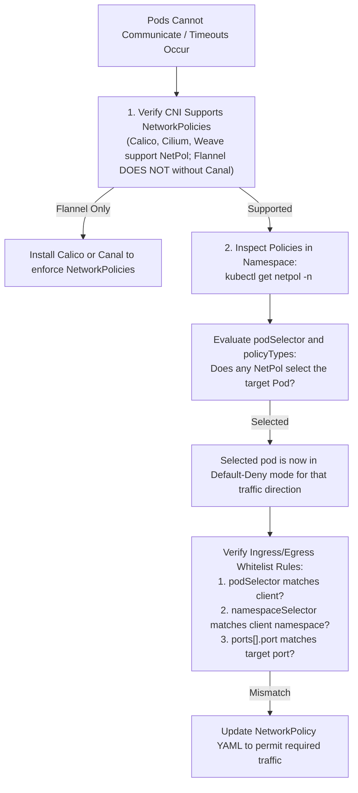
**Diagnostic Explanation:**  
NetworkPolicies are silent drop filters. If `flannel` is used alone, policies are silently ignored without error. When debugging, test reachability with `kubectl exec -it <pod> -- nc -zvw3 <ip> <port>`.

---

## 50. PersistentVolume & Claim Stuck in Pending / Binding Failure
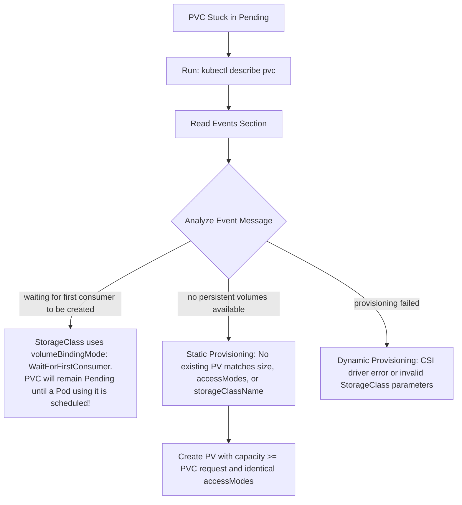
**Diagnostic Explanation:**  
`volumeBindingMode: WaitForFirstConsumer` is standard practice. It delays volume creation until the Pod is placed on a node, ensuring the storage volume is provisioned in the same availability zone as the node.

---

## 51. Volume Mount Failure: Multi-Attach Error & Node Lock
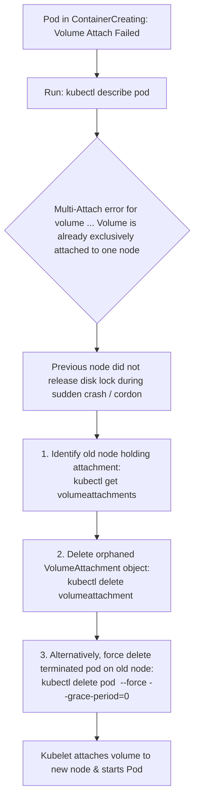
**Diagnostic Explanation:**  
Cloud block storage (EBS, GPD, Cinder) can only attach to one VM at a time (`ReadWriteOnce`). When a node crashes, the `csi-attacher` waits for safe detachment before allowing a new host to mount the volume.

---

## 52. Dynamic Storage Provisioner Failure & StorageClass Tree
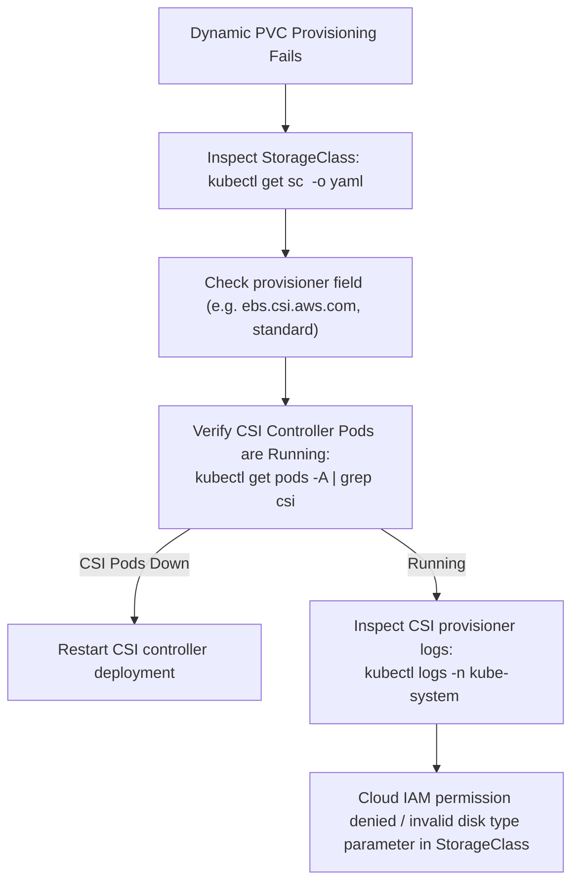
**Diagnostic Explanation:**  
Dynamic volume provisioning depends on the in-cluster CSI storage controller. If PVC provisioning fails without events, inspect the `csi-provisioner` container logs in `kube-system`.

---

## 53. RBAC Unauthorized (403 Forbidden) Audit
```mermaid
flowchart TD
    RBACFail["API Error: 403 Forbidden: User 'X' cannot 'verb' 'resource' in namespace 'Y'"] --> Step1["Test permissions with auth can-i:<br/>kubectl auth can-i <verb> <resource> --as=<user> -n <namespace>"]
    
    Step1 --> CheckRole["Inspect Role / ClusterRole:<br/>Does any rule grant verb on resource?"]
    CheckRole -- Missing Verb/Resource --> UpdateRole["Add required apiGroups, resources, and verbs to Role"]
    
    CheckRole -- Rule Exists --> CheckBinding["Inspect RoleBinding / ClusterRoleBinding"]
    CheckBinding --> CheckSubject{"Does subjects[] match User/Group/ServiceAccount exactly?"}
    CheckBinding -- Namespace Mismatch --> FixBinding["Ensure ServiceAccount namespace in subjects matches its true namespace"]
    CheckBinding -- Typo in Name --> FixSubject["Correct user/group/serviceaccount name"]
```
**Diagnostic Explanation:**  
Always use `kubectl auth can-i <verb> <resource> --as=<user> -n <ns>` to verify permissions without switching contexts. Common errors include forgetting `apiGroups` (e.g., `apps` for deployments) or referencing a ServiceAccount in the wrong namespace in `subjects`.

---

## 54. Certificate Expiration & kubeadm certs Renewal
```mermaid
flowchart TD
    CertAlert["Cluster Down / Cert Expiration Warning"] --> CheckDates["Run: kubeadm certs check-expiration"]
    CheckDates --> ScanTable["Inspect Expiration Date for all Control Plane Certificates"]
    
    ScanTable --> Expired{"Any Certificate Expired?"}
    Expired -- Yes --> RenewCommand["Run: kubeadm certs renew all"]
    RenewCommand --> RestartPods["Restart Control Plane Static Pods:<br/>Move manifests temporarily out of /etc/kubernetes/manifests/ and back<br/>or: kill -s SIGHUP $(pgrep kube-apiserver)"]
    RestartPods --> UpdateAdminConf["Update local admin.conf:<br/>cp /etc/kubernetes/admin.conf ~/.kube/config"]
    UpdateAdminConf --> Verify["Verify kubectl get nodes succeeds"]
```
**Diagnostic Explanation:**  
Kubernetes control plane certificates created by `kubeadm` expire after 1 year. The renewal process takes less than 2 minutes using `kubeadm certs renew all`, followed by reloading the static pods.

---

## 55. Cluster Upgrade Failure & Node Version Skew Recovery
```mermaid
flowchart TD
    UpgradeFail["kubeadm upgrade plan or apply fails"] --> CheckError{"Analyze Upgrade Error"}
    
    CheckError -- "version skew violation" --> SkewRule["Kubernetes requires upgrading minor versions sequentially (e.g. 1.30 -> 1.31 -> 1.32). NEVER skip minor versions!"]
    
    CheckError -- "control plane not ready" --> HealthCheck["Ensure all nodes are Ready and etcd is healthy before starting upgrade"]
    
    CheckError -- "apt-get / package hold error" --> Unhold["Unhold packages: sudo apt-mark unhold kubeadm kubelet kubectl<br/>Install target version: sudo apt-get install -y kubeadm=1.31.2-1.1<br/>Hold packages: sudo apt-mark hold kubeadm"]
    
    Unhold --> Reapply["Run: sudo kubeadm upgrade apply v1.31.2"]
```
**Diagnostic Explanation:**  
Upgrades must follow strict sequence: Control Plane first (`kubeadm upgrade apply`, then upgrade `kubelet`), followed by worker nodes one-by-one (`kubeadm upgrade node`, drain, upgrade `kubelet`, uncordon).

---

## 56. Worker Node Join Failure: Token & Discovery Timeout
```mermaid
flowchart TD
    JoinFail["kubeadm join times out or throws token error"] --> CheckMsg{"Analyze Join Error"}
    
    CheckMsg -- "token has expired" --> CreateToken["Generate new join token on Control Plane:<br/>kubeadm token create --print-join-command"]
    
    CheckMsg -- "discovery token CA hash mismatch" --> GetHash["Compute correct CA hash on Control Plane:<br/>openssl x509 -pubkey -in /etc/kubernetes/pki/ca.crt |<br/>openssl rsa -pubin -outform der 2>/dev/null |<br/>openssl dgst -sha256 -hex | sed 's/^.* //'"]
    
    CheckMsg -- "connection refused / timeout to 6443" --> TestNet["Test network connectivity from worker to control plane:<br/>nc -zvw3 <control-plane-ip> 6443"]
    
    CreateToken --> RunJoin["Execute corrected kubeadm join command on worker"]
```
**Diagnostic Explanation:**  
Bootstrap tokens expire after 24 hours. If joining a worker node after token expiration, generate a fresh join command using `kubeadm token create --print-join-command`.

---

## 57. High CPU & Memory Throttling: CFS Quota Investigation
```mermaid
flowchart TD
    Throttle["Application Latency Spikes / High CPU Alarm"] --> Step1["Check Pod Resource Metrics:<br/>kubectl top pods -n <namespace>"]
    Step1 --> Step2["Check Node Resource Metrics:<br/>kubectl top nodes"]
    
    Step2 --> CheckCgroup["SSH to Worker Node & Inspect CFS Throttling:<br/>cat /sys/fs/cgroup/cpu/kubepods/.../cpu.stat"]
    CheckCgroup --> MetricEval{"nr_throttled > 0 and throttled_time is high?"}
    
    MetricEval -- Yes --> FixLimit["Pod is hitting CPU Limits ceiling.<br/>Increase resources.limits.cpu or remove CPU limit (best practice for latency-sensitive apps)"]
    MetricEval -- No --> AppProfile["Application thread contention or external bottleneck"]
```
**Diagnostic Explanation:**  
CPU throttling occurs when a container attempts to burst beyond its CFS quota. Removing or raising CPU limits allows workloads to utilize idle CPU cycles without degrading latency.

---

## 58. DiskPressure & Node Eviction: Ephemeral Storage Cleanup
```mermaid
flowchart TD
    DiskPress["Node Condition: DiskPressure = True<br/>Pods Evicted with The node was low on resource: ephemeral-storage"] --> SSH["SSH to Affected Node"]
    SSH --> CheckDisk["Check Disk Usage: df -h /"]
    
    CheckDisk --> Step1["1. Prune unused images and exited containers:<br/>crictl rmi --prune"]
    Step1 --> Step2["2. Clean up large container logs:<br/>truncate -s 0 /var/log/pods/*/*/*.log"]
    Step2 --> Step3["3. Inspect /var/lib/kubelet for orphaned pod directories"]
    
    Step3 --> Recover["Disk utilization drops below threshold (85%) -> Node DiskPressure clears to False"]
```
**Diagnostic Explanation:**  
When node disk utilization exceeds 85%, kubelet initiates hard eviction of Pods consuming excessive ephemeral storage. Clearing old container images with `crictl rmi --prune` immediately restores disk headroom.

---

## 59. PID Pressure & Kernel Process Exhaustion
```mermaid
flowchart TD
    PIDPress["Node Condition: PIDPressure = True"] --> CheckPIDs["SSH to Node & Check Process Count:<br/>ps -eLf | wc -l<br/>sysctl kernel.pid_max"]
    
    CheckPIDs --> FindCulprit["Identify container leaking threads/processes:<br/>ps aux --sort -nlwp | head -n 20"]
    FindCulprit --> KillProcess["Drain node & restart runaway container"]
    
    KillProcess --> EnforceLimit["Add Pod PID Limits in kubelet configuration:<br/>podPidsLimit: 4096 in /var/lib/kubelet/config.yaml"]
```
**Diagnostic Explanation:**  
A fork-bomb or process leak inside a container can exhaust the Linux kernel PID table, causing the entire host to freeze. Modern kubelets enforce `podPidsLimit` to isolate process leaks to the offending container.

---

## 60. StatefulSet Out-of-Order Pod Startup & PVC Orphan Cleanup
```mermaid
flowchart TD
    StatefulFail["StatefulSet pod db-1 will not start"] --> Step1["Check previous ordinal db-0:<br/>kubectl get pod db-0"]
    Step1 --> IsReady{"Is db-0 in Running & Ready state?"}
    
    IsReady -- No --> FixDB0["StatefulSets require sequential startup.<br/>Fix db-0 before db-1 can be scheduled!"]
    
    IsReady -- Yes --> CheckPVC["Check PVC: kubectl get pvc data-db-1"]
    CheckPVC --> PVCMissing{"Does PVC exist?"}
    PVCMissing -- No --> RecreatePVC["Ensure volumeClaimTemplates is correctly defined in StatefulSet spec"]
```
**Diagnostic Explanation:**  
By default (`podManagementPolicy: OrderedReady`), StatefulSets require pod $N-1$ to pass all readiness checks before pod $N$ is created. If pod 0 is crashing, pod 1 will never start.

---

## 61. Helm Release Stuck in Pending-Install / Pending-Upgrade
```mermaid
flowchart TD
    HelmStuck["Helm command fails: release X has another operation in progress"] --> ListReleases["Run: helm list -a"]
    ListReleases --> CheckStatus{"Status: pending-install or pending-upgrade?"}
    
    CheckStatus -- Yes --> Step1["Identify Helm Secret storing release state:<br/>kubectl get secret -l owner=helm,name=<release-name>"]
    Step1 --> Step2["Delete the pending secret version:<br/>kubectl delete secret sh.helm.release.v1.<name>.v<latest-rev>"]
    Step2 --> Step3["Re-run helm rollback or helm upgrade"]
```
**Diagnostic Explanation:**  
Helm 3 stores release state in Kubernetes Secrets within the release namespace. When a deployment is interrupted, the release state gets stuck in `pending-upgrade`. Deleting the hung secret releases the state lock.

---

## 62. Custom Resource Definition (CRD) Validation & Operator Errors
```mermaid
flowchart TD
    CRDFail["Error creating Custom Resource: validation failure"] --> Step1["Inspect CRD Schema: kubectl describe crd <crd-name>"]
    Step1 --> CheckVersion["Verify apiVersion and kind match CRD spec.group and spec.names"]
    
    CheckVersion --> Step2["Inspect Operator Logs:<br/>kubectl logs -n <operator-ns> -l app=<operator-name>"]
    Step2 --> OperatorCrash{"Is operator reconciler throwing panic / errors?"}
    OperatorCrash -- Yes --> RBACCheck["Verify Operator ServiceAccount has RBAC rights to manage the Custom Resource"]
```
**Diagnostic Explanation:**  
Custom Resources require valid OpenAPI v3 schemas in the CRD definition. If a valid CR is created but never reconciled, inspect the operator pod logs for RBAC authorization failures.

---

## 63. DaemonSet Pod Missing on Specific Worker Node
```mermaid
flowchart TD
    DSMissing["DaemonSet pod not running on worker-02"] --> DescribeNode["Inspect Node: kubectl describe node worker-02"]
    DescribeNode --> CheckTaints["Check Taints on worker-02"]
    
    CheckTaints --> HasCustomTaint{"Does node have custom taints?"}
    HasCustomTaint -- Yes --> AddToleration["Add matching toleration to DaemonSet spec.template.spec.tolerations"]
    
    HasCustomTaint -- No --> CheckSelector["Check nodeSelector & nodeAffinity in DaemonSet spec"]
    CheckSelector --> LabelMatch{"Does worker-02 have required labels?"}
    LabelMatch -- No --> LabelNode["Label node: kubectl label node worker-02 <key>=<value>"]
    LabelMatch -- Yes --> CheckResources["Check if worker-02 is out of CPU or memory"]
```
**Diagnostic Explanation:**  
DaemonSet pods automatically tolerate standard node conditions, but custom operational taints (e.g., `gpu=true:NoSchedule`) or specific `nodeSelectors` will prevent DaemonSet scheduling unless declared.

---

## 64. Master Exam Day Time-Management & Emergency Task Rescue
```mermaid
flowchart TD
    ExamTask["New CKA Exam Task Presented"] --> Step1["1. IMMEDIATELY SWITCH CONTEXT:<br/>kubectl config use-context <context-name>"]
    Step1 --> Step2["2. Set Namespace Variable:<br/>NS=<task-namespace> (or append -n $NS to all commands)"]
    
    Step2 --> AssessTime{"Can this task be completed in under 6 minutes?"}
    AssessTime -- No / Complex & Confusing --> FlagTask["FLAG TASK FOR REVIEW & MOVE TO NEXT TASK IMMEDIATELY"]
    
    AssessTime -- Yes --> ImperativeFirst["Use Imperative Generators:<br/>kubectl create / run ... --dry-run=client -o yaml > task.yaml"]
    ImperativeFirst --> ApplyTask["vim task.yaml && kubectl apply -f task.yaml"]
    ApplyTask --> FastVerify["Run Quick Verification:<br/>kubectl get pod/svc -n $NS && curl test"]
    FastVerify --> PassNext["Task Complete -> Proceed to Next Task"]
```
**Diagnostic Explanation:**  
The golden rule of the CKA exam: **Never spend more than 8 minutes on a single task on the first pass**. If a task is unclear, flag it, skip it, and capture all easy points across the remaining tasks before returning.
